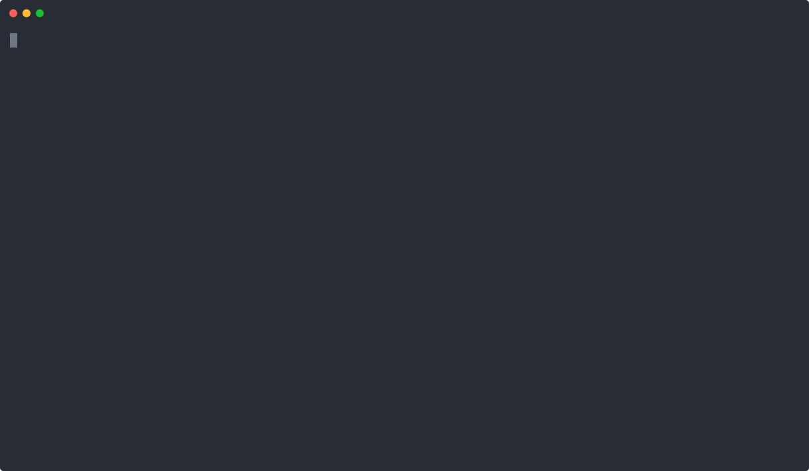

<br/>
<br/>
<p align="center">
  
  <p align="center">Ensures the correctness of your CODEOWNERS file.</p>
</p>
<br/>
<br/>
<br/>
<br/>

## Codeowners Validator
<a href="/LICENSE"></a>
<a href="https://goreportcard.com/report/github.com/mlarraz/codeowners-validator"></a>

The Codeowners Validator project validates the GitHub [CODEOWNERS](https://help.github.com/articles/about-code-owners/) file based on [specified checks](#checks). It supports public and private GitHub repositories and also GitHub Enterprise installations.



## Usage

#### Docker

```bash
export GH_TOKEN=<your_token>
docker run --rm -v $(pwd):/repo -w /repo \
  -e REPOSITORY_PATH="." \
  -e TRUST_WORKSPACE="true" \
  -e GITHUB_ACCESS_TOKEN="$GH_TOKEN" \
  -e EXPERIMENTAL_CHECKS="notowned" \
  -e OWNER_CHECKER_REPOSITORY="org-name/rep-name" \
  ghcr.io/mlarraz/codeowners-validator:v0.8.0
```

#### Command line

```bash
export GH_TOKEN=<your_token>
env REPOSITORY_PATH="." \
    GITHUB_ACCESS_TOKEN="$GH_TOKEN" \
    EXPERIMENTAL_CHECKS="notowned" \
    OWNER_CHECKER_REPOSITORY="org-name/rep-name" \
  codeowners-validator
```

#### GitHub Action

```yaml
- uses: actions/checkout@v7
  with:
    # Only the CODEOWNERS file is needed, see docs/gh-action.md
    sparse-checkout: .github/CODEOWNERS
    sparse-checkout-cone-mode: false
    persist-credentials: false
- uses: mlarraz/codeowners-validator@v0.8.0
  with:
    checks: "files,owners,duppatterns,syntax"
    experimental_checks: "notowned,avoid-shadowing"
```

Check [this](./docs/gh-action.md) document for more information about GitHub Action.

----

Check the [Configuration](#configuration) section for more info on how to enable and configure given checks.

## Installation

It's highly recommended to install a fixed version of `codeowners-validator`. Releases are available on the [releases page](https://github.com/mlarraz/codeowners-validator/releases).

### macOS & Linux

#### Install script

```bash
# binary installed into ./bin/
curl -sfL https://raw.githubusercontent.com/mlarraz/codeowners-validator/main/install.sh | sh -s v0.8.0

# binary installed into $(go env GOPATH)/bin/codeowners-validator
curl -sfL https://raw.githubusercontent.com/mlarraz/codeowners-validator/main/install.sh | sh -s -- -b $(go env GOPATH)/bin v0.8.0

# In alpine linux (as it does not come with curl by default)
wget -O - -q https://raw.githubusercontent.com/mlarraz/codeowners-validator/main/install.sh | sh -s v0.8.0

# Print version. Add `-o short` to print just the version number.
codeowners-validator version
```

You can also download [latest version](https://github.com/mlarraz/codeowners-validator/releases/latest) from release page manually.

#### From Sources

You can install `codeowners-validator` with `go install github.com/mlarraz/codeowners-validator@v0.8.0`.

> NOTE: please use Go 1.27.3 or greater.

This will put `codeowners-validator` in `$(go env GOPATH)/bin`.

## Checks

The following checks are enabled by default:

| Name        | Description                                                                                                                                                                                                                                                                                                                                                                                                                                                                                                                                                                                                                                                                                                                  |
|-------------|------------------------------------------------------------------------------------------------------------------------------------------------------------------------------------------------------------------------------------------------------------------------------------------------------------------------------------------------------------------------------------------------------------------------------------------------------------------------------------------------------------------------------------------------------------------------------------------------------------------------------------------------------------------------------------------------------------------------------|
| duppatterns | **[Duplicated Pattern Checker]** <br /><br /> Reports if CODEOWNERS file contain duplicated lines with the same file pattern.                                                                                                                                                                                                                                                                                                                                                                                                                                                                                                                                                                                                |
| files       | **[File Exist Checker]** <br /><br /> Reports if CODEOWNERS file contain lines with the file pattern that do not match any file tracked in a given repository. Patterns are matched the way GitHub matches them.                                                                                                                                                                                                                                                                                                                                                                                                                                                                                                                                                                                |
| owners      | **[Valid Owner Checker]** <br /><br /> Reports the errors GitHub finds in the CODEOWNERS file, using the [CODEOWNERS errors API](https://docs.github.com/en/rest/repos/repos#list-codeowners-errors): owners that don't exist, aren't visible, or don't have write access to the repository, invalid owners, and invalid patterns. It's the same evaluation GitHub uses to request reviews, so GitHub must have the commit being validated. See [GitHub authentication](./docs/gh-auth.md) for the credentials it needs. |
| syntax      | **[Valid Syntax Checker]** <br /><br /> Reports if CODEOWNERS file contain invalid syntax definition. It is imported as: <br />&nbsp;&nbsp;&nbsp;&nbsp;"If any line in your CODEOWNERS file contains invalid syntax, the file will not be detected<br />&nbsp;&nbsp;&nbsp;&nbsp;and will not be used to request reviews. Invalid syntax includes inline comments <br />&nbsp;&nbsp;&nbsp;&nbsp;and user or team names that do not exist on GitHub." <br /> <br /> _source: https://help.github.com/articles/about-code-owners/#codeowners-syntax_.                                                                                                                                                                           |

The experimental checks are disabled by default:

| Name            | Description                                                                                                                                                                                                                                                                                                                                                                                                                                                                                                                                                                     |
|-----------------|---------------------------------------------------------------------------------------------------------------------------------------------------------------------------------------------------------------------------------------------------------------------------------------------------------------------------------------------------------------------------------------------------------------------------------------------------------------------------------------------------------------------------------------------------------------------------------|
| notowned        | **[Not Owned File Checker]** <br /><br /> Reports files tracked in a given repository that no CODEOWNERS entry matches.                                                                                                                                                                                                                                                                                                                                                                                                                                     |
| avoid-shadowing | **[Avoid Shadowing Checker]** <br /><br /> Reports if entries go from least specific to most specific. Otherwise, earlier entries are completely ignored. <br /><br />For example:<br />&nbsp;&nbsp;&nbsp;&nbsp; `# First entry`<br />&nbsp;&nbsp;&nbsp;&nbsp; `/build/logs/ @octocat` <br />&nbsp;&nbsp;&nbsp;&nbsp; `# Shadows` <br />&nbsp;&nbsp;&nbsp;&nbsp; `*            @s1` <br />&nbsp;&nbsp;&nbsp;&nbsp; `/b*/logs     @s5` <br />&nbsp;&nbsp;&nbsp;&nbsp; `# OK` <br />&nbsp;&nbsp;&nbsp;&nbsp; `/b*/other    @o1` <br />&nbsp;&nbsp;&nbsp;&nbsp; `/script/*	   @o2` |

To enable experimental checks set the `EXPERIMENTAL_CHECKS` environment variable, for example `EXPERIMENTAL_CHECKS=notowned`.

No check reads the contents of any file but CODEOWNERS: `files` and `notowned` read the list of tracked files from Git's index, so a sparse, blobless checkout that contains only the CODEOWNERS file is enough.

Check the [Configuration](#configuration) section for more info on how to enable and configure given checks.

## Configuration

Use the following environment variables to configure the application:

| Name                                          | Default                       | Description                                                                                                                                                                                                                                                                                                                                                                                                                                                     |
|-----------------------------------------------|:------------------------------|:----------------------------------------------------------------------------------------------------------------------------------------------------------------------------------------------------------------------------------------------------------------------------------------------------------------------------------------------------------------------------------------------------------------------------------------------------------------|
| <tt>REPOSITORY_PATH</tt> <b>*</b>             |                               | Path to your repository on your local machine. A sparse checkout that contains only the CODEOWNERS file is enough.                                                                                                                                                                                                                                                                                                                                              |
| <tt>TRUST_WORKSPACE</tt>                      | `false`                       | Specifies whether Git should trust the repository path even though another user owns it, for example when it's mounted into a container. See: https://github.com/actions/checkout/issues/766.                                                                                                                                                                                                                                                                 |
| <tt>GITHUB_ACCESS_TOKEN</tt>                  |                               | GitHub token for the `owners` check. It needs read access to the repository contents, see [GitHub authentication](./docs/gh-auth.md). Without credentials, the check only works for public repositories and is limited to 60 requests per hour.                                                                                                                                                                                                                |
| <tt>GITHUB_BASE_URL</tt>                      | `https://api.github.com/`     | GitHub base URL for API requests. Defaults to the public GitHub API but can be set to a domain endpoint to use with GitHub Enterprise.                                                                                                                                                                                                                                                                                                                          |
| <tt>GITHUB_UPLOAD_URL</tt>                    | `https://uploads.github.com/` | GitHub upload URL for uploading files. <br> <br>It is taken into account only when `GITHUB_BASE_URL` is also set. If only `GITHUB_BASE_URL` is provided, this parameter defaults to the `GITHUB_BASE_URL` value.                                                                                                                                                                                                                                                |
| <tt>GITHUB_APP_ID</tt>                        |                               | GitHub App ID for authentication. When set, the app is used instead of `GITHUB_ACCESS_TOKEN`. Instruction for creating a GitHub App can be found [here](./docs/gh-auth.md)                                                                                                                                                                                                                                                                                     |
| <tt>GITHUB_APP_INSTALLATION_ID</tt>           |                               | Github App Installation ID. Required when `GITHUB_APP_ID` is set.                                                                                                                                                                                                                                                                                                                                                                                               |
| <tt>GITHUB_APP_PRIVATE_KEY</tt>               |                               | Github App private key in PEM format. Required when `GITHUB_APP_ID` is set.                                                                                                                                                                                                                                                                                                                                                                                     |
| <tt>CHECKS</tt>                               |                               | List of checks to be executed. By default, all checks are executed. Possible values: `files`,`owners`,`duppatterns`,`syntax`.                                                                                                                                                                                                                                                                                                                                   |
| <tt>EXPERIMENTAL_CHECKS</tt>                  |                               | The comma-separated list of experimental checks that should be executed. By default, all experimental checks are turned off. Possible values: `notowned`,`avoid-shadowing`.                                                                                                                                                                                                                                                                                     |
| <tt>CHECK_FAILURE_LEVEL</tt>                  | `warning`                     | Defines the level on which the application should treat check issues as failures. Defaults to `warning`, which treats both errors and warnings as failures, and exits with error code 3. Possible values are `error` and `warning`.                                                                                                                                                                                                                             |
| <tt>OWNER_CHECKER_REPOSITORY</tt>  <b>*</b>   |                               | The owner and repository name separated by slash, for example gh-codeowners/codeowners-samples. The `owners` check validates this repository's CODEOWNERS file on GitHub.                                                                                                                                                                                                                                                                                      |
| <tt>OWNER_CHECKER_REF</tt>                    | commit checked out in `REPOSITORY_PATH` | The branch, tag, or commit SHA whose CODEOWNERS file the `owners` check validates. It must exist on GitHub. If `REPOSITORY_PATH` isn't a Git repository, defaults to the repository's default branch.                                                                                                                                                                                                                                       |
| <tt>OWNER_CHECKER_IGNORED_OWNERS</tt>         | `@ghost`                      | The comma-separated list of owners that should not be validated. Example: `"@owner1,@owner2,@org/team1,example@email.com"`.                                                                                                                                                                                                                                                                                                                                     |
| <tt>OWNER_CHECKER_ALLOW_UNOWNED_PATTERNS</tt> | `true`                        | Specifies whether CODEOWNERS may have unowned files. For example: <br> <br>  `/infra/oncall-rotator/                    @sre-team` <br>  `/infra/oncall-rotator/oncall-config.yml` <br> <br>  The `/infra/oncall-rotator/oncall-config.yml` file is not owned by anyone.                                                                                                                                                                                        |
| <tt>OWNER_CHECKER_OWNERS_MUST_BE_TEAMS</tt>   | `false`                       | Specifies whether only teams are allowed as owners of files.                                                                                                                                                                                                                                                                                                                                                                                                    |
| <tt>NOT_OWNED_CHECKER_SKIP_PATTERNS</tt>      |                               | The comma-separated list of patterns that should be ignored by `not-owned-checker`. For example, you can specify `*` and as a result, the `*` pattern from the **CODEOWNERS** file will be ignored and files owned by this pattern will be reported as unowned unless a later specific pattern will match that path. It's useful because often we have default owners entry at the begging of the CODOEWNERS file, e.g. `*       @global-owner1 @global-owner2` |
| <tt>NOT_OWNED_CHECKER_SUBDIRECTORIES</tt>     |                               | The comma-separated list of subdirectories to check in `not-owned-checker`. When specified, only files in the listed subdirectories will be checked if they do not have specified owners in CODEOWNERS.                                                                                                                                                                                                                                                         |

 <b>*</b> - Required (`OWNER_CHECKER_REPOSITORY` only by the `owners` check)

#### Exit status codes

Application exits with different status codes which allow you to easily distinguish between error categories.

| Code  | Description                                                                               |
|:-----:|:------------------------------------------------------------------------------------------|
| **1** | The application startup failed due to the wrong configuration or internal error.          |
| **2** | The application was closed because the OS sends a termination signal (SIGINT or SIGTERM). |
| **3** | The CODEOWNERS validation failed - executed checks found some issues.                     |

## Contributing

Contributions are greatly appreciated! The project follows the typical GitHub pull request model. See [CONTRIBUTING.md](CONTRIBUTING.md) for more details.
